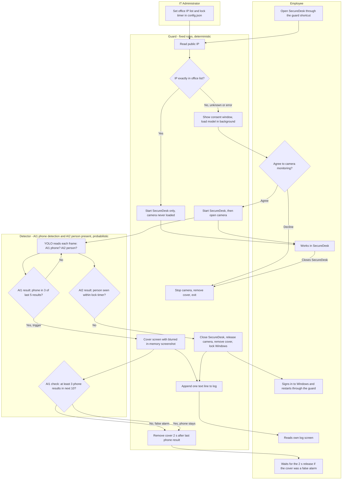
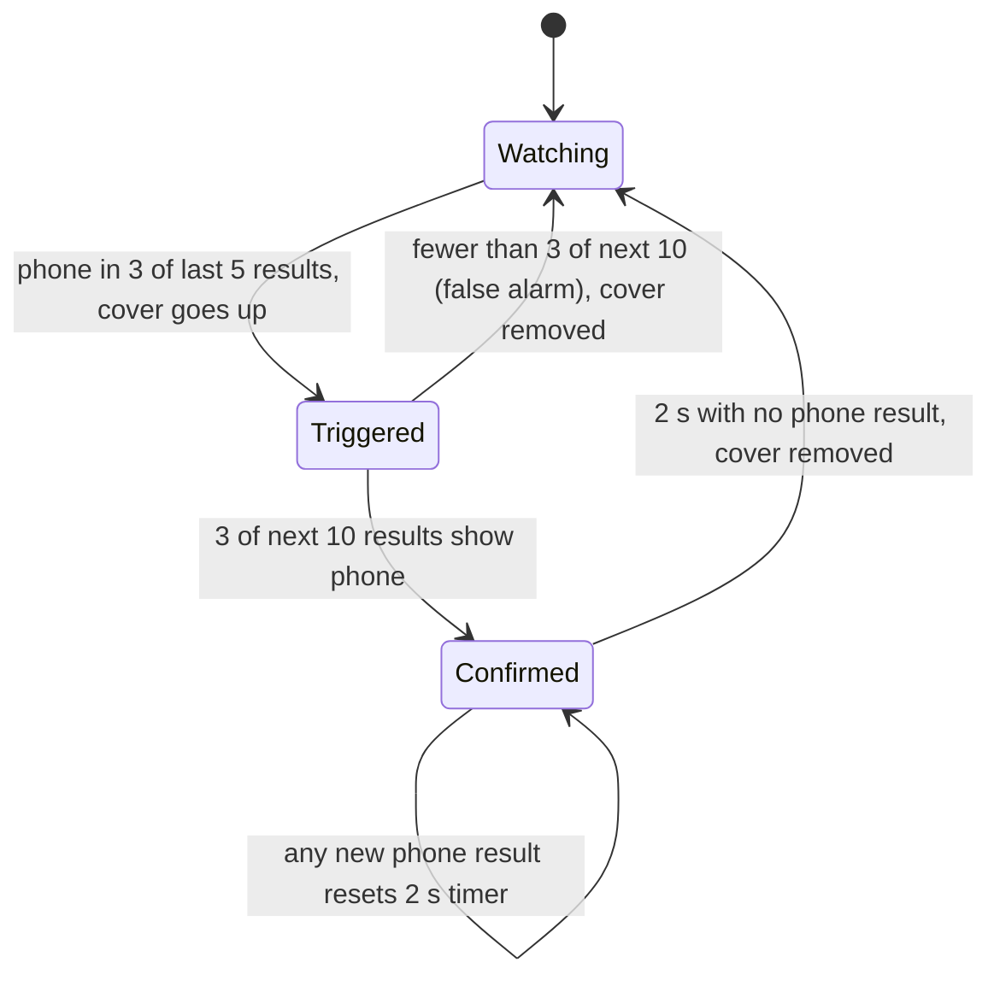
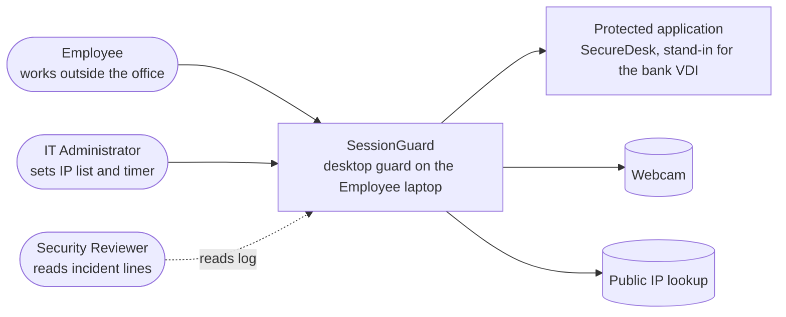
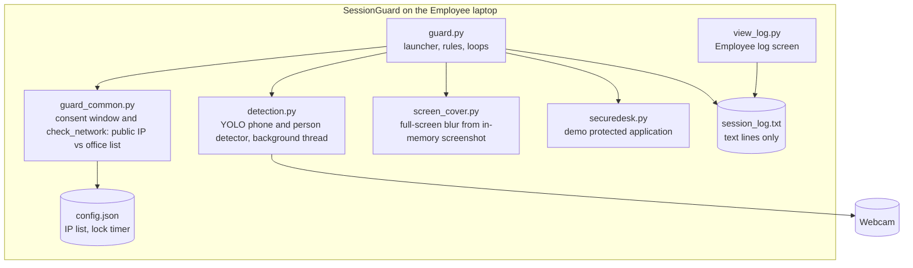

# 02 – Workflow and Architecture
Team 020 – SessionGuard | Members: see `README.md`

## 1. Workflow (swimlane)
Lanes: IT Administrator, Employee, Guard (fixed rules), Detector (AI, probabilistic).

### AI steps and human gates
AI is used in two places, both by the same detector: **AI1** looks for a phone and **AI2** looks for a person. Everything around them is a fixed rule.

| Step | AI or fixed rule | Human gate |
|---|---|---|
| Office check | Fixed rule | None, automatic |
| Consent | The Employee’s decision | **Human decides** (Agree or Decline) |
| AI1: phone detection | AI, then fixed rules (3 of 5 to trigger, 3 of the next 10 to confirm) | None. Runs straight through; the cover clears by itself 2 seconds after the phone is gone |
| AI2: person present | AI, then a timer | None. Runs straight through; the Employee signs in to Windows again after a lock |
| Log | Fixed rule: one text line per incident | The Employee reads it and the Security Reviewer reviews it afterwards |

**Why the cover and the lock run straight through.** A human approval step would be too slow to stop a photo that takes about two seconds. The risk is handled instead by the confirm step, the 2-second release, and the Employee being able to see why the screen was covered.

### Where the AI is uncertain, and the fallback
| Point | Uncertainty | Fallback |
|---|---|---|
| Phone detection | Can miss (angle, light, partly hidden) or react to a look-alike | Frame rules cut one-frame errors; a false cover clears in 2 s; misses are a stated limit |
| Person present | Can miss a person who sits very still or is out of frame | Timer then lock; sign in again with the normal Windows password |
| Office check | Not AI. A stale IP list gives the wrong mode | Unknown IP is treated as outside (fail-safe) |
| Camera failure | Not AI | Protected application closes with a popup; never unmonitored. A read that hangs forever is not caught in V1 |

### AI cost and reliability
- Runs on the laptop. No cloud, no per-call fee, no tokens.
- Recorded speed on the development laptop (CPU only): about 146 ms per frame at image size 640, about 81 ms at 416. The final setting is 512 (see `08_Detection_Tuning_Log.md`).
- What the Employee sees: the small camera window shows HIGH RISK or No risk.

## 2. Control loops inside the guard
The product is a set of small loops that each watch one thing. This table lists them all.

| # | Loop | Runs how often | What it watches | What it does |
|---|---|---|---|---|
| L1 | Camera read loop | Every camera frame | New frame arrives | Hands the frame to the detector; shows the small window |
| L2 | Detector loop (background thread) | As fast as the CPU allows | Latest frame | Finds phone and person; keeps the video smooth |
| L3 | Trigger window | Per detector result | Phone in 3 of the last 5 results | Puts the cover up at once |
| L4 | Confirm window | Per detector result, 10 results after trigger | Phone in at least 3 of 10 | Keeps the cover, or removes it as a false alarm |
| L5 | Sliding grace window | Per detector result | Time since the last phone result | Removes the cover after 2 s with no phone; every new phone result resets the 2 s |
| L6 | Absence timer | Per detector result | Time since a person (confidence ≥ 0.5) was last seen | At the timer: close application, release camera, lock Windows |
| L7 | Webcam health check | Continuous | More than 30 failed reads in a row, 0.05 s apart (about 1.5 s) | Close the protected application and show a popup |
| L8 | Process watch | Continuous | The protected application is still running | If it closes: stop camera, remove cover, exit |
| L9 | Exit paths | On event | `q`, window close (X), crash | Same clean stop as L8; cover and camera are always released |
| L10 | Model warm-up and background load | Once per session | Model loads while the consent window is open | Avoids an unmonitored gap after Agree |

## 3. Phone detection state machine

## 4. C4 level 1 – System context

## 5. C4 level 2 – Containers

**Deployment:** one Windows laptop, Python virtual environment, model file `yolo11s.pt` next to the code. No server of our own. Our code makes one network call: the public-IP lookup. The detection library adds its own calls (see `04_Data_Privacy_Ethics_Risk.md`).
