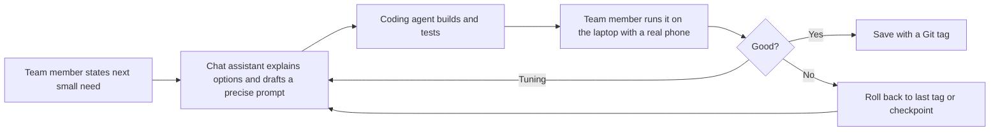

# 09 – AI Collaboration Log
Team 020 – SessionGuard | Members: see `README.md`

## 1. How AI was used, by the three pillars of the course
| Pillar | Use in this project |
|---|---|
| AI for management artifacts | Claude (chat) helped plan the idea, draft the Topic Approval Form, the PRD, the diagrams and these files. A team member reviewed and corrected every file |
| AI to build the product | Claude Code on a Windows laptop wrote and tested the Python prototype in small steps, with Git save points |
| AI inside the product | A pretrained YOLO object detector (traditional computer vision). No generative AI runs inside the product |

## 2. Working pattern

Rules the team member set: one small step at a time; explain before doing; "do not change X" in every prompt; investigate before changing when something breaks; report every result.

## 3. Real prompts (extracts, in the order used; "…" marks text left out; in P8 the number of seconds was a setting, shown here as N)
**P1 – first detection test**
> Write a new script called test_detection.py that opens the webcam, runs the pretrained YOLOv8n model on the live feed, and prints out the names of any objects it detects in the console (like "person" or "cell phone") in real time. Don't add any blur or blocking logic yet — just show me what it detects. Press 'q' to quit.

**P2 – tuning, reaction time and verify step**
> Two changes to the detection logic: 1. Lower the initial trigger from 6-out-of-10 frames to 3-out-of-5 frames, so it reacts faster while still requiring some consistency (not a single frame). 2. Once blur triggers, keep evaluating the next 10 frames in the background. If fewer than 3 of those next 10 frames also detect "cell phone," cancel the blur immediately as a false alarm. If 3 or more do, keep the blur active and continue the existing 2-second sliding-window grace period from there.

**P3 – investigate, do not change** (used when phones were missed)
> The app often misses my phone now. It worked better before I added the consent screen and before the speed changes (confidence 0.35, image size 416, background thread). Do not change any code yet. Please find out what is going wrong. Check these: …

**P4 – a controlled fix with a constraint**
> Apply fixes 1 and 2. Set confidence to 0.25 and image size to 512. Keep the background thread. Make the blur faster by blurring a shrunken copy of the frame and scaling it back up. Change nothing else. Then run the app.

**P5 – measurement before action**
> The camera takes a long time to open after I click Agree. Do not change any code yet. Measure how many seconds each startup stage takes: (1) importing torch and ultralytics, (2) loading the yolo11s model, (3) opening the webcam, (4) getting the first frame. Then tell me which stage is slowest and what you would change.

**P6 – guard wrapper with protected detection logic**
> Connect the camera and phone detection to guard.py. Do not change securedesk.py. Do not change the detection logic itself (3 of 5 frames, 10-frame check, 2-second grace period, yolo11s, current confidence and image size).

**P7 – real screen cover**
> When detection enters HIGH RISK, take one screenshot of the main screen in memory, blur it strongly, and show it as a borderless, full-screen, always-on-top window over the whole screen. … Do not save the screenshot to disk. Delete it from memory when the cover goes away. … The cover must also be removed when SecureDesk closes, when the guard exits, when 'q' or the X is used, and if the code crashes. The screen must never stay covered after the guard stops.

**P8 – absence lock with ordered steps and safety lines**
> If no person has been seen for N seconds in a row, do these steps in this order: close SecureDesk; stop detection and release the webcam; remove any screen cover; lock the Windows workstation using the built-in Windows lock; then exit the guard. There is no auto unlock and no auto restart. … Do not store images. Do not identify who the person is. Only detect whether a person is present. … The absence lock must run only while monitoring is ON … The screen cover must never get stuck, and the webcam light must go off before the lock.

**P9 – minimal logging, designed with failure in mind**
> Write one line per event … If writing to the log fails, ignore the error and keep running. Logging must never crash the guard or leave the screen covered. Add session_log.txt to .gitignore.

**P10 – save point**
> Make a NEW commit with all current changes. Skip venv, .pt files, config.json and session_log.txt. Use the message … Add a Git tag … Do not push. Do not amend any earlier commit.

## 4. Where the team member overruled or corrected the AI
| # | AI suggestion | Team member's decision | Why |
|---|---|---|---|
| 1 | Lower confidence to 0.15 | Dialled back after a mouse was covered | False covers destroy trust |
| 2 | Blur on the first phone frame | Reduced to a multi-frame rule, then cut 6-of-10 to 3-of-5 | Wanted faster response with consistency, and a way to remove the cover if it was not a phone |
| 3 | Size and shape filters | Rejected: "I don't want to disturb the model" | Risk of missing real phones |
| 4 | CLIP second check | Removed after it broke rotated phones | Fixing one problem created another |
| 5 | Larger model YOLO11m | Rolled back | Too slow on a CPU laptop |
| 6 | Speed settings 0.35 and 416 | Reverted to 0.25 and 512 after phones were missed | Accuracy per frame is amplified by the 3-of-5 rule |
| 7 | Two simulated tick boxes for office and critical screen | Replaced by an IT-managed IP list | A real deployable rule that IT can own |
| 8 | Ask for the office IP at start | Changed to a predefined IP in `config.json` | The product should not ask the Employee to declare the office |
| 9 | Open a protected PDF in our own window | Rejected | Breaks the business purpose |
| 10 | Monitor which files are open | Rejected | Breaks the no-monitoring rule |
| 11 | Wide logging | Cut to incidents only | Minimisation by decision |
| 12 | Admin analytics screen | Dropped; Employee screen only | Protects trust |
| 13 | Configurable protected application with setup window | Reverted, moved to V2 | Risk and time |
| 14 | The assistant said an earlier state was not saved | Corrected: the checkpoint feature had it | The team member asked about Rewind and tested it |

## 5. Where the AI was wrong or unreliable
- Predicted that lower confidence would help and then needed to be corrected by testing.
- Proposed CLIP, which looked right on paper and failed on rotation.
- An early rollback by rewriting from specification did not reproduce the old behaviour.
- A second look at its own work found inconsistent numbers in a draft document (a 1-second and a 3-second blur target). These were fixed.
- It cannot see a webcam, so every detection claim had to come from the team member's live tests.

## 6. How the team checked AI output
1. Syntax check and scripted tests run by the coding agent (16 logic checks, 10 start/stop scenarios).
2. A live test by the team member with the real phone.
3. A scan before every commit for real IP addresses and e-mail in staged files.
4. Reading every prompt answer for claims that were not tested.
5. The professor's own test on the documents (below).

## 7. The professor's self-check
**Prompt:** "Read these files. Can you build this product without clarification? List ambiguities and missing items."
**Result on the earlier draft set (14 Nov 2026):**
| # | Ambiguity found | Action |
|---|---|---|
| 1 | Cover time said 1 second in one place and 3 seconds in another | Fixed. Cover timing is stated once, as a target of 3 s or less on average (`01_PRD.md` section 8) |
| 2 | 90-day retention was a proposal; the log has no automatic deletion | Stated plainly in `04_Data_Privacy_Ethics_Risk.md`; enforcement planned for V2 |
| 3 | Trigger of the absence lock | Confirmed against the build: no person seen for N seconds in a row |
| 4 | Business figures are assumptions | Marked (A) in `06_Business_Case_and_Economics.md` |
| 5 | Fairness gap of 10 points was a target with no test | Test T8 in `05_Model_and_Evaluation.md` |
| 6 | Office check is an IP simulation | Stated as a limit in three files |

## 8. Read-only audit of the documents against the code (14 Nov 2026)
The coding agent that wrote the code was asked, in read-only mode, to answer 11 questions from the actual files and Git history. It changed nothing. Differences it found, and what we did:
| # | Finding | Action |
|---|---|---|
| 1 | The cover goes up at the first trigger, before confirmation. A cancelled false alarm still writes "covered" and "removed" lines | Workflow, state machine, PRD and UX files corrected |
| 2 | Consent is also asked when the IP lookup fails or `config.json` is missing or broken (treated as outside). The old `app.py` treats that case as monitoring off | PRD scope item 3 corrected; `app.py` marked as an older stand-alone version |
| 3 | The consent text mentions phones only; the camera also checks presence | Stated as a gap, then fixed in V1.1 (commit `540f846`); text in `03_UX_and_Trust_Design.md` |
| 4 | The model loads before the Employee answers consent. The camera stays closed, but the library does DNS lookups and may send anonymous statistics even on Decline | Stated plainly in `04_Data_Privacy_Ethics_Risk.md`; fixed in V1.1 (`YOLO_OFFLINE=1`, commit `540f846`), checked at Python level |
| 5 | The absence lock force-closes the application, releases the camera and removes any cover before locking | PRD and risk table corrected |
| 6 | A second log wording exists for a failed Windows lock | Added to the full log-line list |
| 7 | "Logs only incident lines" holds; "cover removed" can also be written at shutdown | Noted in the log-line list |
| 8 | `network_check.py` is an old stand-alone script; the guard uses `check_network` in `guard_common.py` | Architecture diagram and prototype README corrected |
| 9 | Rules count detector results, not camera frames | Definitions corrected |
| 10 | Webcam open has no timeout; a read that hangs forever is not caught | Added to risks |
| 11 | No image or video is written by project code; the screenshot is taken in memory | Confirmed in the data section |
Versions and Git dates from the audit are used in `05_Model_and_Evaluation.md` and `07_Build_Journey_and_Iterations.md`.
